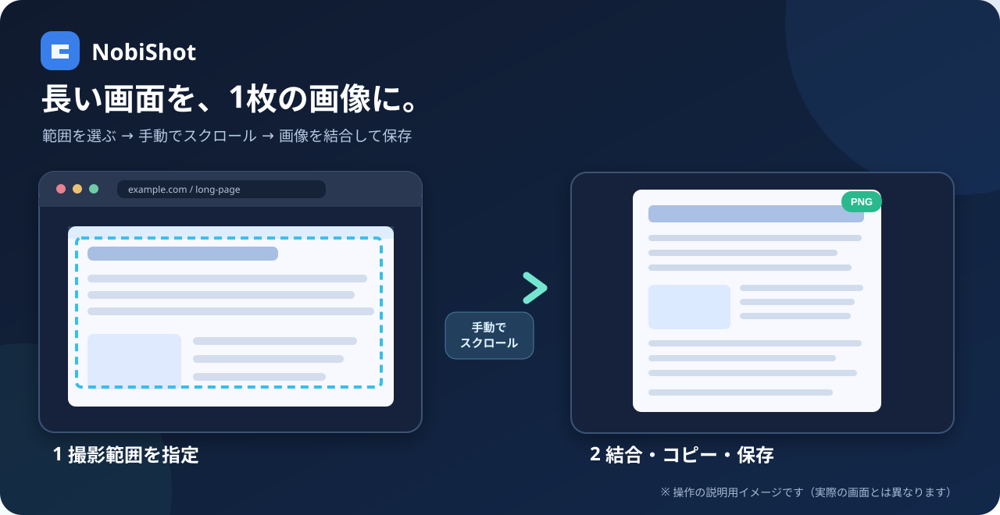

# NobiShot

**NobiShot（ノビショット）** は、Windows向けのスクロール画面キャプチャツールです。

**NobiShotは、長いWebページや設定画面を1枚の画像として保存できる無料のWindowsアプリです。** 撮影したい横幅と上下位置を指定し、手動でスクロールするだけ。画像の重なりを照合して縦長の画像に結合します。固定ヘッダーを1回だけ残す撮影にも対応しています。

> ※上の図は使い方を示す**説明用イメージ**であり、実際のアプリ画面ではありません。

> **無料ダウンロード**：[NobiShot v1.1.15（Windows版）](../../releases/tag/v1.1.15) から配布用ZIPを入手できます。支援なしで全機能を利用できます。

## NobiShotでできること

- **長いWebページを1枚に**：途中で分割された画面を、重なりを確認しながら結合
- **範囲を選んで撮影**：必要な横幅と上下の範囲だけを指定
- **固定ヘッダーにも対応**：スクロールしても残る部分を先頭に1回だけ保存
- **コピー・保存が簡単**：結果をCtrl+Cでコピー、Ctrl+SでPNG保存

**こんな用途に**：Webサイトの記録、AWSなどの設定画面の証跡、長いマニュアルや手順画面の保存。

## 特徴

- 撮影範囲の横幅・上下位置を指定できる
- 手動スクロールによる連続キャプチャと画像の結合
- 固定ヘッダーを最初に1回だけ保存可能
- 撮影中の上下ガイドを画面上の同じ位置に固定
- F7で撮影操作、プレビューでCtrl+Cによるコピー・Ctrl+SによるPNG保存
- ライト／ダークテーマ

## ダウンロード

**[NobiShot v1.1.15（Windows版）をダウンロード](../../releases/tag/v1.1.15)**

Releaseページの **Assets → `NobiShot_v1.1.15_Windows.zip`** を選んでください。

配布ZIPに含まれる `NobiShot.exe` を起動します。EXE版を使用する場合、Pythonのインストールは不要です。

**対応環境**：Windows 11を主な対象としています。Windows 10の一部環境でも動作する設計ですが、すべてのPC・モニター構成での動作を保証するものではありません。

## 開発支援（任意）

NobiShotは**無料で利用できるアプリ**です。支援や会員登録をしなくても、すべての機能を利用できます。

継続的な機能改善や使いやすさの向上を応援していただける場合は、Ko-fiから任意でご支援いただけます。支援額は**300円から**設定できます（決済画面の通貨・金額をご確認ください）。

**[NobiShotの開発を応援する（Ko-fi）](https://ko-fi.com/nobishot3)**

支援の有無による機能の違いはありません。

## 使い方

### 固定ヘッダー「なし」（通常の撮影）

1. 撮影対象のページを開き、NobiShotを起動する。
2. F7で開始し、必要ならページをスクロールして開始位置を調整する。
3. F7で選択画面に進み、横方向にドラッグして**撮影上端と横幅**を指定する。
4. クリックして**撮影下端**を指定する。
5. ページを手動で少しずつスクロールする。
6. F7を押し、最後に含めたい位置をクリックして終了する。
7. プレビューで確認し、**Ctrl+C**でコピー、または**Ctrl+S**でPNGとして保存する。

### 固定ヘッダー「あり」

スクロールしても動かないヘッダーを、完成画像の上部に1回だけ残したい場合に使用します。

1. 最初の選択画面で**ヘッダー上端と横幅**を指定する。
2. **ヘッダー下端**をクリックする。この位置が同時に**本文撮影の開始位置**になる。
3. ページを手動でスクロールする。この間も本文は撮影対象になる。
4. F7を押して**本文撮影の下端**をクリックする。
5. 上下の固定ガイドを目安にスクロール撮影を続ける。
6. もう一度F7を押し、最後に含めたい位置をクリックして終了する。

最終画像は「固定ヘッダー1回分 ＋ スクロールした本文」として結合されます。

## 注意事項

- 自動スクロール機能はありません。**手動で短めにスクロール**してください。
- 動画、アニメーション、広告、動的コンテンツ、繰り返し模様などでは、画像の重なりを照合できない場合があります。
- 画像の連続性を確認できない場合は、無理に結合せず部分画像として警告します。保存前にプレビューで欠落や重複を確認してください。
- NobiShotは画面に表示される内容を撮影します。個人情報や機密情報を含む画面の取り扱いには注意してください。
- 撮影画像をNobiShot独自のサーバーへアップロードする機能はありません。設定により、元画像や検証用データがPC内に保存される場合があります。
- F7キーは撮影中などにNobiShotの操作へ割り当てられ、他のアプリのF7操作と競合する場合があります。

## バージョン

- **v1.1.15**：固定ヘッダーの上端・下端指定と本文撮影開始の操作順を改善

## フィードバック

不具合や改善の提案は、このリポジトリの [Issues](../../issues) で受け付けます。報告するスクリーンショットやログに、個人情報・パスワード・社内情報などが含まれないようにしてください。

---

NobiShotはWindows向けの無料スクロールキャプチャツールです。
