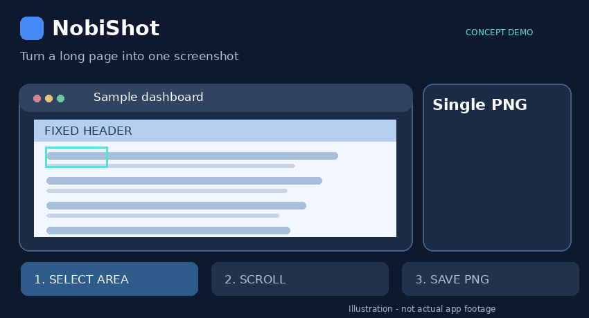

# NobiShot

**NobiShot（ノビショット）** は、Windows向けのスクロール画面キャプチャツールです。

**NobiShotは、長いWebページや設定画面を1枚の画像として保存できる無料のWindowsアプリです。** 撮影したい横幅と上下位置を指定し、手動でスクロールするだけ。画像の重なりを照合して縦長の画像に結合します。固定ヘッダーを1回だけ残す撮影にも対応しています。

## ひと目でわかるNobiShot



**撮影範囲を選択 → 手動でスクロール → 長い画像を1枚に結合**。上のGIFは操作の流れを示す**説明用アニメーション**です（実際のアプリ画面の録画ではありません）。

[静止画で操作の流れを見る](docs/images/overview.svg)

> **無料ダウンロード**：[NobiShot v1.1.15（Windows版）](../../releases/tag/v1.1.15) から配布用ZIPを入手できます。支援なしで全機能を利用できます。
>
> **使い方で困ったら**：[よくある質問（FAQ）](#よくある質問faq) を確認してください。

## NobiShotでできること

- **長いWebページを1枚に**：途中で分割された画面を、重なりを確認しながら結合
- **範囲を選んで撮影**：必要な横幅と上下の範囲だけを指定
- **固定ヘッダーにも対応**：スクロールしても残る部分を先頭に1回だけ保存
- **コピー・保存が簡単**：結果をCtrl+Cでコピー、Ctrl+SでPNG保存

**こんな用途に**：Webサイトの記録、AWSなどの設定画面の証跡、長いマニュアルや手順画面の保存。

## 特徴

- 撮影範囲の横幅・上下位置を指定できる
- 手動スクロールによる連続キャプチャと画像の結合
- 固定ヘッダーを最初に1回だけ保存可能
- 撮影中の上下ガイドを画面上の同じ位置に固定
- F7で撮影操作、プレビューでCtrl+Cによるコピー・Ctrl+SによるPNG保存
- ライト／ダークテーマ

## ダウンロード

**[NobiShot v1.1.15（Windows版）をダウンロード](../../releases/tag/v1.1.15)**

Releaseページの **Assets → `NobiShot_v1.1.15_Windows.zip`** を選んでください。

配布ZIPに含まれる `NobiShot.exe` を起動します。EXE版を使用する場合、Pythonのインストールは不要です。

**対応環境**：Windows 11を主な対象としています。Windows 10の一部環境でも動作する設計ですが、すべてのPC・モニター構成での動作を保証するものではありません。

## 開発支援（任意）

NobiShotは**無料で利用できるアプリ**です。支援や会員登録をしなくても、すべての機能を利用できます。

継続的な機能改善や使いやすさの向上を応援していただける場合は、Ko-fiから任意でご支援いただけます。支援額は**300円から**設定できます（決済画面の通貨・金額をご確認ください）。

**[NobiShotの開発を応援する（Ko-fi）](https://ko-fi.com/nobishot3)**

支援の有無による機能の違いはありません。

## 使い方

### 固定ヘッダー「なし」（通常の撮影）

1. 撮影対象のページを開き、NobiShotを起動する。
2. F7で開始し、必要ならページをスクロールして開始位置を調整する。
3. F7で選択画面に進み、横方向にドラッグして**撮影上端と横幅**を指定する。
4. クリックして**撮影下端**を指定する。
5. ページを手動で少しずつスクロールする。
6. F7を押し、最後に含めたい位置をクリックして終了する。
7. プレビューで確認し、**Ctrl+C**でコピー、または**Ctrl+S**でPNGとして保存する。

### 固定ヘッダー「あり」

スクロールしても動かないヘッダーを、完成画像の上部に1回だけ残したい場合に使用します。

1. 最初の選択画面で**ヘッダー上端と横幅**を指定する。
2. **ヘッダー下端**をクリックする。この位置が同時に**本文撮影の開始位置**になる。
3. ページを手動でスクロールする。この間も本文は撮影対象になる。
4. F7を押して**本文撮影の下端**をクリックする。
5. 上下の固定ガイドを目安にスクロール撮影を続ける。
6. もう一度F7を押し、最後に含めたい位置をクリックして終了する。

最終画像は「固定ヘッダー1回分 ＋ スクロールした本文」として結合されます。

## よくある質問（FAQ）

### Q. ダウンロードしたZIPから起動できません

[Releases](../../releases) から配布用の `NobiShot_v1.1.15_Windows.zip` をダウンロードし、**ZIPをすべて展開してから** `NobiShot.exe` を実行してください。EXE版の利用にPythonのインストールは不要です。ZIP内から直接起動するのではなく、展開先のフォルダから起動してください。

### Q. Windowsから「PCが保護されました」などの警告が表示されます

Windowsのセキュリティ機能によって警告が表示される場合があります。**警告が出たからといって安全性・危険性のどちらかが確定するわけではありません。** まず、ファイルがこのリポジトリの公式 [Releases](../../releases) から入手したものかを確認してください。

必要に応じて、Releaseに添付された `SHA256.txt` とダウンロードしたZIPのハッシュ値を照合できます。PowerShellでZIPのあるフォルダを開き、次を実行します。

```powershell
Get-FileHash .\NobiShot_v1.1.15_Windows.zip -Algorithm SHA256
```

ハッシュ値は**ファイルの一致確認**に使えますが、それだけで安全性を保証するものではありません。入手元や内容を確認できない場合は実行しないでください。

### Q. F7キーを押しても反応しません

NobiShotが起動していて、撮影操作中の状態か確認してください。一部のノートPCでは `Fn + F7` が必要な場合があります。ほかのアプリがF7を使用している場合は競合する可能性があるため、競合するショートカットを終了・変更してから試してください。

### Q. スクロールしても撮影が進まない／画像がずれる・一部が欠ける

**短い距離ずつ、ゆっくり手動でスクロール**してください。前後の画面に共通して表示される部分が残るように操作すると、重なりの照合がしやすくなります。動く広告、アニメーション、動画、遅れて読み込まれるコンテンツがあるページでは、結合が難しい場合があります。まずは動きの少ないページでも試してください。

撮影を終了したら、プレビューで画像の欠落や重複がないか確認してください。

### Q. 固定ヘッダーが重複する／ヘッダーと本文の境目が不自然です

スクロールしても動かないヘッダーがあるページでは、**固定ヘッダー「あり」**を選択し、ヘッダーの上端・下端を指定してください。固定ヘッダーのないページでは「なし」を選択してください。詳細は上の「使い方」を参照してください。

### Q. 完成した画像はどうやってコピー・保存しますか？

撮影完了後の**プレビュー画面**で、`Ctrl + C` でクリップボードにコピー、`Ctrl + S` でPNG形式として保存できます。

### Q. Windows 10でも使用できますか？

主な対象はWindows 11です。Windows 10の一部環境でも動作する設計ですが、すべての環境での動作は保証していません。問題が起きた場合は、Windowsのバージョンを添えて報告してください。

### Q. 撮影した画像はインターネットに送信されますか？

NobiShotには、撮影画像をNobiShot独自のサーバーへアップロードする機能はありません。ただし、設定によっては元画像や検証用データがPC内に保存される場合があります。個人情報・機密情報のある画面を撮影する際は、保存場所と取り扱いに注意してください。

### Q. 不具合や改善案はどこに報告すればよいですか？

[Issuesの作成画面](../../issues/new/choose)から、「不具合報告」または「機能改善・新機能の提案」を選択してください。スクリーンショットやログを添付する場合は、**個人情報、ローカルPCのユーザー名、社内情報、パスワード、トークン**を必ず除去してください。

## 注意事項

- 自動スクロール機能はありません。**手動で短めにスクロール**してください。
- 動画、アニメーション、広告、動的コンテンツ、繰り返し模様などでは、画像の重なりを照合できない場合があります。
- 画像の連続性を確認できない場合は、無理に結合せず部分画像として警告します。保存前にプレビューで欠落や重複を確認してください。
- NobiShotは画面に表示される内容を撮影します。個人情報や機密情報を含む画面の取り扱いには注意してください。
- 撮影画像をNobiShot独自のサーバーへアップロードする機能はありません。設定により、元画像や検証用データがPC内に保存される場合があります。
- F7キーは撮影中などにNobiShotの操作へ割り当てられ、他のアプリのF7操作と競合する場合があります。

## バージョン

- **v1.1.15**：固定ヘッダーの上端・下端指定と本文撮影開始の操作順を改善

## フィードバック

不具合の報告や機能の提案は、[Issueテンプレートの選択画面](../../issues/new/choose)から受け付けます。**不具合報告**と**機能改善・新機能の提案**の2種類があります。報告するスクリーンショットやログに、個人情報・パスワード・社内情報などが含まれないようにしてください。

---

NobiShotはWindows向けの無料スクロールキャプチャツールです。
